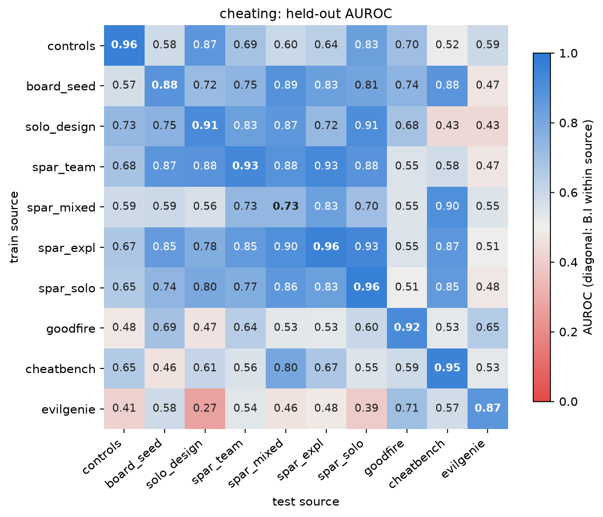
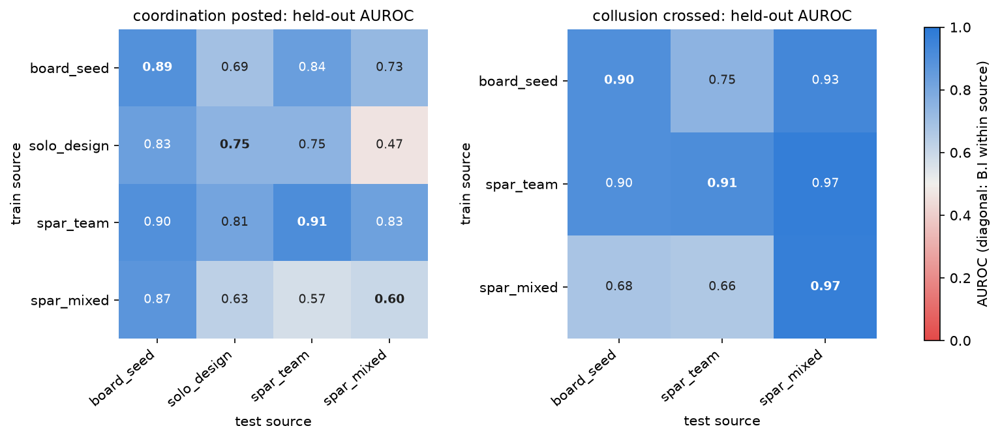

# Supplementary tables

Ian Rios-Sialer, Independent

Correspondence: unrulyabstractions@gmail.com

These tables accompany the paper Hermeneutics for swarm collusion monitoring and give every cell behind its tables. The sections follow the questions a reader asks of the paper; each opens with what its tables show, and every table says what its rows and columns are. Table numbers S1, S2 and so on refer to this document; the paper's tables keep their own names.

## Supplement

### Data and provenance

These tables say which authors wrote the controls and what the controls dataset holds per author and arm. The label-gap map then says which of the six outputs each source can label at all.

**Table S.** Controls: authors and reader. Rows: the five authors, then the reader; columns: the API model id, whether the weights are open, the valid runs, and think coverage, the share of turns with readable reasoning over every valid run.

<<TM1>>

**Table S.** The controls dataset and the probed subsample. Rows: author and arm; columns: valid runs by label, probed agents by label, probed turns, and probed turns with readable reasoning.

<<TM2>>

**Table S.** The label-gap map. Rows: the six outputs; columns: what each source provides. Direct means a logged label; derivable means a rule over the logs that a reader or judge should confirm; zero by construction follows from the label hierarchy for single-agent runs; judge only means no deterministic label exists.

<<T6>>

The outputs are nested: scheming implies collusion, collusion implies cheating and collaboration, collaboration implies cooperation, and cooperation implies coordination. The single-agent controls therefore label cheating directly and give the other five as zeros by construction. AI Village, frontier agents sharing a group chat, gives coordination and collaboration by derivation and cooperation only weakly; it needs a judge for cheating, collusion and scheming. Among our runs, only the <<N_BOARD>> board-seed runs and the design runs label coordination directly.

### Six ladders by task

These tables give five of the six ladders level by level, with the evidence per task family. The paper's Table G1 defines all six and its Table G2 gives collusion; the first two here are the framework's own [@cierniak2026spar].

**Table S.** Cheating (direct). Rows: each level reached, first with its rule for all tasks and then with its evidence per task family; columns: level, task, evidence.

<<TG1>>

**Table S.** Coordination above posted: the framework's collaboration ladder (direct). Rows and columns as in the cheating table.

<<TG2>>

**Table S.** Cooperation (proxy). Rows and columns as in the cheating table.

<<TG3>>

**Table S.** Collaboration (proxy). Rows and columns as in the cheating table.

<<TG4>>

**Table S.** Scheming (proxy). Rows and columns as in the cheating table.

<<TG6>>

### Controls and nulls

These tables test whether the controls' probe reads cheating rather than a layer, an arm, the author or the prompt. They end with the lexical-only null and an audit of which result rows carry a label-shuffle null.

<<TB1>>

<<TB2>>

**Table S.** Controls, both arms pooled and the cheat arm alone. Rows: the methods of the paper's Table D1; columns: B.I pooled AUROC in each arm. The probe rows use layer 38, close position; the Sonnet judge scored <<SON_D3>> agents; the cheap judges and the reader interrogation were not run on the cheat arm alone.

<<TD3>>

**Table S.** Controls: nuisance readouts and the cheating probe under erasure. Rows: what is read out and from which arm; columns: raw, author erased, author, task and condition erased, and the chance or majority rate. Accuracy is read against the majority rate and AUROC [95% bootstrap over runs] against chance; the both-arm rows use layer 38, close position.

<<T3>>

**Table S.** The prompt-only control inside every prompt condition. Rows: label, set and condition; columns: restricted, the pooled out-of-fold scores of the paper's Table 6 on that condition's agents, and refit, probes trained and tested inside the condition, with the prompt-only probe's 50-draw null. Conditions with too few agents or runs in a class are left out.

<<T_WITHIN>>

**Table S.** Lexical-only reader null. Rows: label, training scheme and probe type; columns: TF-IDF on the think-window text alone, the agents with a think window, whole-text TF-IDF and the full probe. Agents with an empty think window drop out of the think-window score.

<<T_LEXICAL>>

**Table S.** Label-permutation null audit. Rows: result sets; columns: main-table rows with a null, rows without, and rows whose null the audit computed. <<NULL_LEFT>> rows still lack a null, mostly per-step and per-group rows whose permutation must keep each agent's turns together.

<<T_NULLAUDIT>>

The random-weights reader is planned and not run: it needs a fresh GPU pass of the reader with its weights re-initialised, followed by the same probes.

### Probes per set

These tables give every probe and baseline on each set that the paper's Table 2 summarises. They cover the agent-level probes on the team and design sets, the attention monitor with its baselines and seeds, and the three external sets in detail.

**Table S.** Agent-level linear probes per set and label. Rows: set and label; columns: AUROC of the think pair, the seven tokens and the five boundary tokens at all three layers, of TF-IDF on the agent's words and on the whole text, and of metadata (arm, seed and turn budget), then the 95th percentile of the seven-token probe's label-shuffle null (100 draws, labels shuffled within arm). Workers only, one vector per agent, five folds grouped by run.

<<T_TEAM_SETS>>

**Table S.** Attention monitor and baselines. Rows: set and split; columns: the agents reaching the cut, the monitor's agent AUROC from the last step for seeds 0 and 1 on the think pair and on the seven tokens, the baselines' agent AUROC, and the 95th percentile of the monitor's label-shuffle null with its draws. Controls and SPAR sets: cheating at the task's floor; five folds grouped by run; held-out author trains on the other authors and scores one, pooled over authors. On the team runs and the controls no null draw reached the real value, so p sits at its floor of <<BNULL_P>> and <<CNULL_P>>.

<<T_ATT_FULL>>

**Table S.** Attention monitor, binary head, three seeds on the same folds. Rows: run and label; columns: step AUROC and agent AUROC from the last step, for seeds 0, 1 and 2.

<<T_SEEDS>>

**Table S.** Goodfire, judge run directories, five folds grouped by rollout. Rows: features and baselines; columns: hacked and clean rollouts, pooled AUROC and AUROC inside one run directory [95% bootstrap over rollouts], each with its 50-draw null.

<<T_GF_FOLDS>>

**Table S.** Goodfire, per run directory, from the held-out scores of the table above. Rows: run directories; columns: hacked and clean rollouts, and AUROC inside the directory for the probe at all layers and at layer 26, TF-IDF and metadata.

<<T_GF_RUNDIR>>

**Table S.** CheatBench: the controls-trained probe applied unchanged, per harness. Rows: harnesses and their pool; columns: rollouts, cheating and benign rollouts, AUROC, and the mean probe score of each class. Inside each harness the probe ranks cheating at or above benign; across harnesses the Pilot harness scores far lower and holds most positives, which drives the pooled value below chance.

<<T_CB_HARNESS>>

**Table S.** CheatBench: the same scores split by whether a positive and a negative share a harness. Rows: kinds of positive-negative pair; columns: their count and the AUROC over them.

<<T_CB_PAIRS>>

**Table S.** EvilGenie, five folds keeping each matched pair whole. Rows: features and baselines; columns: hacked and legitimate rollouts, pooled AUROC, and AUROC inside one author, one problem, or both. Problems are close to one label each, so the pooled result is mostly problem identity.

<<T_EG>>

### Unseen authors and transfer

These tables and figures show how each method does on an author or a source it never saw. They back the paper's Tables 3 and 4.

**Table S.** Attention monitor and baselines per held-out author. Rows: set and held-out author; columns: agents reaching the cut, the monitor's agent AUROC from the last step over two seeds, and the baselines' agent AUROC.

<<T_AUTH>>

**Figure S.** Controls, solo arm: transfer to an unseen author. Each method is trained on four authors and scores the held-out author's agents (type B.II). Markers are held-out AUROC with <<FIG_CI>> bootstrap intervals over runs, and the dashed line marks chance. Filled markers are reader probes (PCA and every dimension at all layers, per-turn at layer <<FIG_TURN_LAYER>>); the hollow marker is the TF-IDF classifier on the whole transcript. The line under each author's name is its think coverage over all its valid runs. The paper's Table D2 gives the values.

**Figure S.** Cheating transfer between sources. A linear probe trained on every labelled agent of the row source scores every labelled agent of the column source. The diagonal is B.I within the source. The mean off-diagonal AUROC is <<MX_OFFDIAG>>.

**Figure S.** Coordination and collusion transfer between sources. Coordination at posted and collusion at crossed, between the sources with a board, as in the figure above.

### Architectures

These tables give the probe matrix behind the paper's Table 4: every probe type on every inclusion scheme, then the nine architectures on the main cells. The cells at or below their null, and the cells not run, are listed after the tables.

**Table S.** Probe matrix, cheating. Rows: inclusion schemes; columns: type A (mean over authors), B.I with its interval and counts (agents, positives, runs, authors), the B.I null's 95th percentile (20 draws), TF-IDF and metadata on the same folds, and B.II (mean over held-out authors) with its counts. Each cell reads the think pair at all layers pooled over turns.

<<T_MX_CHEAT>>

**Table S.** Probe matrix, coordination at posted. Rows and columns as in the cheating table. The external sets have no board.

<<T_MX_COORD>>

**Table S.** Probe matrix, collusion at crossed. Rows and columns as in the cheating table.

<<T_MX_COLL>>

**Table S.** Architectures, type B.I. Rows: label and inclusion scheme; columns: the nine architectures' held-out AUROC, mean over seeds. Blank: not planned, or no feasible split.

<<T_MX_ARCH_BI>>

**Table S.** Architectures, type B.II. Rows: label and inclusion scheme; columns: the architectures' held-out AUROC, mean over seeds and held-out authors. Blank: not planned, or no feasible split.

<<T_MX_ARCH_BII>>

**Cells at or below their null.** The linear probe's B.I score sits at or below the 95th percentile of its null in these cells: <<MX_AT_NULL>>.

**Cells not run.** The architectures were not planned for type A, for the external and transfer schemes, or for B.II of the leave-one-source-out schemes. <<MX_INFEASIBLE>> planned architecture cells had no feasible split, because one author or too few agents in a class left nothing to hold out. Architectures 2 to 9 carry no permutation null.

### Per step

These tables score monitors on every turn and time their first alarm after the onset. They back the paper's Table 5 and its comparison with turn position.

**Table S.** Board-seed teams, per step (one row per turn, the label the level reached at that call). Rows: features and baselines; columns: for cheating at used and for collusion at crossed, turn AUROC [95% bootstrap over runs], the delay with its interquartile range, and the agents detected. The per-step permutation null's 95th percentile lies between <<STEP_NULL>> for the think pair and seven tokens.

<<T_STEP_FULL>>

**Table S.** Probe matrix per step, layer 38, one row per turn, positive from the agent's onset on. Rows: label, scheme and features; columns: turn AUROC [95% CI], the turn null's 95th percentile, agent AUROC, agents detected, the delay from the onset to the first score above the threshold at a 5% false-positive rate, and turns.

<<T_MX_STEPS>>

Per-step onsets map the source's steps to the reader's turns by tool-call rank where the two differ.

### Judges and reader interrogation

These tables give every judge and the reader's own spoken verdict on each set, beside the probe, the monitor and TF-IDF on the same agents. They end with the reader's agreement with its own probe and with what the judges' reading window cuts away.

Each judge reads the task head and the agent's turns with every tool result cut, keeps the last part of the body, and answers one yes-or-no question with a confidence. The reader interrogation asks the reader the same question.

<<T_JUDGE_SETS:S1>>

**Table S.** Reader interrogation against the reader's own probe on the same agents. Rows: set and label; columns: the AUROC of each, the share of agents each calls positive, their agreement and Cohen's kappa. The probe says yes when its held-out logit is above zero.

<<T_INTERROG>>

**Table S.** Does the tail cut hide the onset? Rows: set, label and judge; columns: positives scored, onsets known, onsets inside the reading window, and the judge's AUROC on all positives, on those whose onset it saw and on those whose onset was cut away, each against every negative.

<<T_TAILCUT>>

### Design runs

These tables give the board-seed texts and the first batch of design runs. The paper's Table C1 gives the clean design runs and its Table C2 the board-seed team runs.

**Table S.** The board-seed texts. Rows: message conditions; columns: the text the system posts as the first board message. The anti-coordination condition posts no text; a hidden regulator agent carries it.

<<TC>>

**Table S.** Design runs, first batch. Rows: telling level, system post and author; columns: runs and agents, and the agents that read the board, posted, and reached the task's cheat floor. The design is the paper's Table C1 with the neutral board-seed post at L1 and L2; that post speaks of a team, so it hints at teammates.

<<T_DES_HINT>>

## References
